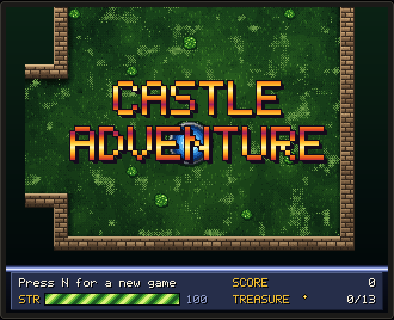
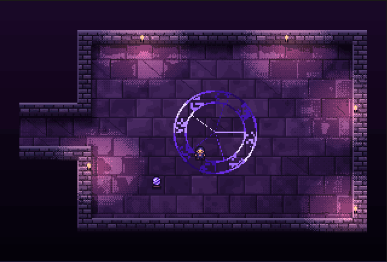
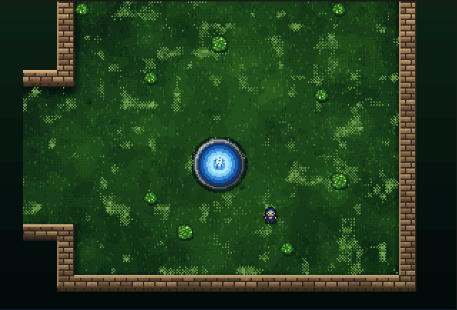
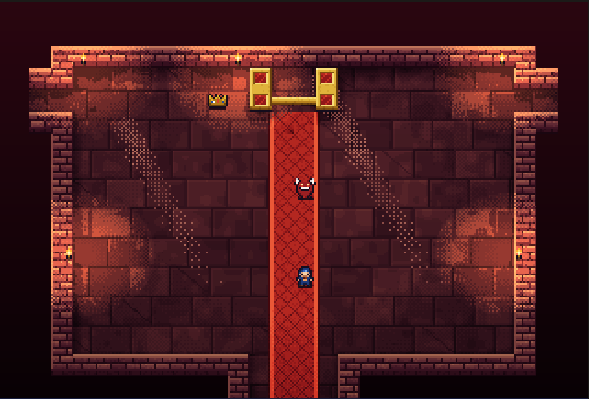
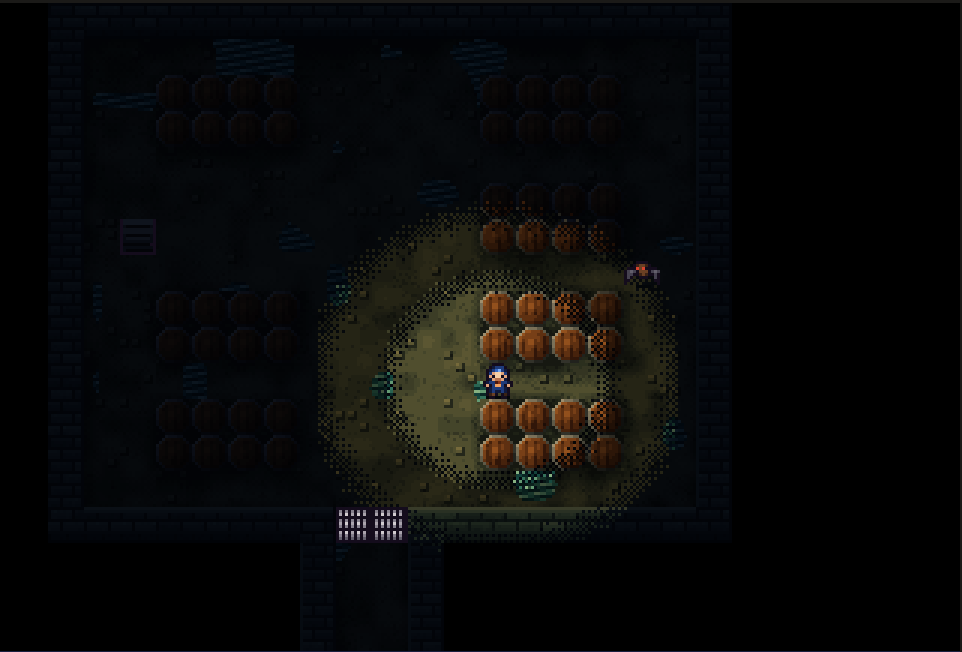
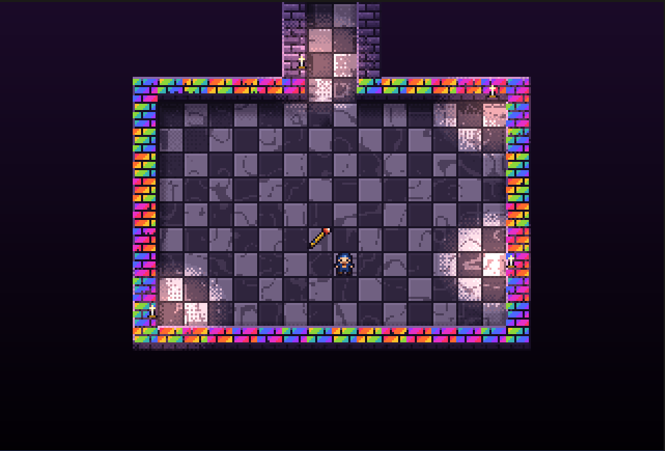
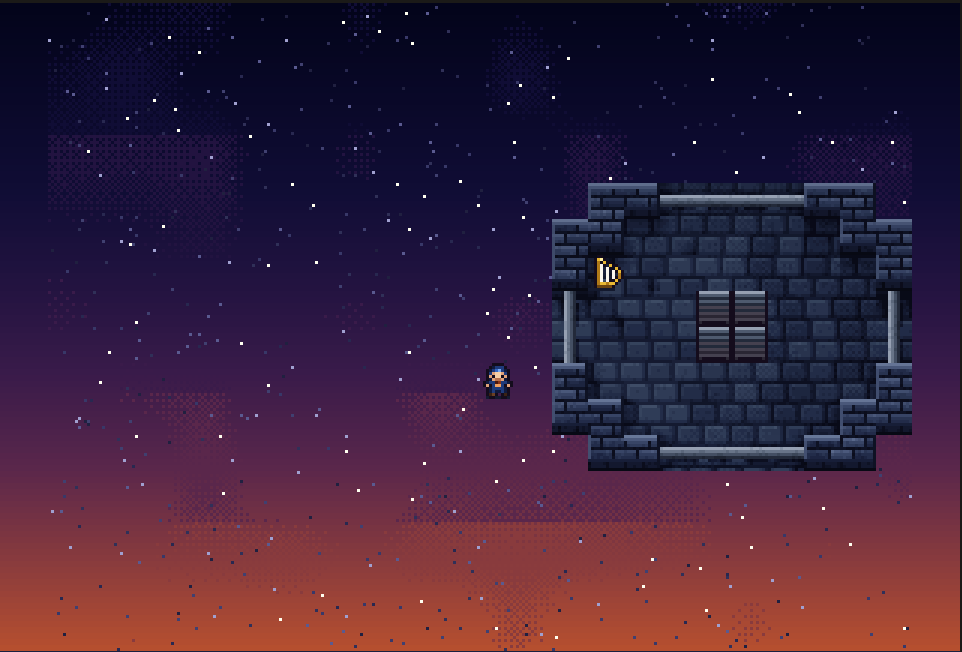

<div align="center">

<a href="https://castles.bmux.sh"></a>

# Castle Adventure

**Kevin Bales' 1984 DOS classic, rebuilt for the browser as if it had shipped on an Amiga 1200.**

<h3><a href="https://castles.bmux.sh">▶&nbsp;&nbsp;PLAY IT NOW AT CASTLES.BMUX.SH&nbsp;&nbsp;◀</a></h3>


</div>

---

> *You are in the Castle Courtyard. To the north is a large Doorway. To the south is a large gate.*

Forty-two years ago, Castle Adventure was 83 rooms of ASCII on a CGA screen. Every room, item,
monster, puzzle and point in this version is still the original, read byte-for-byte out of
`CASTLE.RAN` and `CASTLE.EXE`. What changed is the hardware it pretends to run on.

Every frame is drawn the way the Amiga's **AGA chipset** would draw it: 256 indexed colours across
eight bitplanes, blitter sprites, per-scanline copper gradients, and Mark Ferrari-style
**colour cycling** that makes the water ripple, the torches flicker and the sorcerer's runes turn,
all without redrawing a single pixel.

<div align="center">

 

<sub>Nothing in these loops is redrawn. Only the palette registers change.</sub>

</div>

## 🏰 The castle

<table>
<tr>
<td width="50%"><br><sub><b>The Throne Room.</b> Mind the Angry Demon.</sub></td>
<td width="50%"><br><sub><b>The Royal Wine Cellar.</b> Bring a lamp.</sub></td>
</tr>
<tr>
<td width="50%"><br><sub><b>The King's Secret Room.</b> "The walls are many colors."</sub></td>
<td width="50%"><br><sub><b>Top of the East Tower.</b> Dusk over the battlements.</sub></td>
</tr>
</table>

## 🕹️ Playing

| | |
|---|---|
| **Move** | Arrow keys or `WASD`. Hold two to walk diagonally. |
| **Actions** | Shown in the side panel, with their key. `1`–`9` work too. |
| **Map** | `M` shows the rooms you've explored. |
| **Menu** | `Esc` to save, load or start over. |
| **Phone** | Tap the d-pad under the screen. |

Your progress is saved automatically every time you change rooms.

> **The goal:** escape the castle with all **13 treasures** for the perfect score of **1550**.

## 🧙 Dev mode

Add [`?dev`](https://castles.bmux.sh/?dev) to the URL, or press `` ` ``, to open the dev panel.
From there you can teleport anywhere, spawn items and see hidden things.


| URL | Does |
|---|---|
| `?worldmap` | Opens the whole castle, floor by floor. Click a room to teleport there. |
| `?flyover` | Opens the map and flies the camera through every room. Press `F` on the map to start it. |
| `?room=18&row=10&col=12` | Skips the title screen and starts at a given room and position. |
| `…&reveal` | Shows hidden items and lights up dark rooms. |
| `…&give=lamp,sword` | Starts with these items. |
| `?seed=3` | Uses a fixed random seed. |

`reveal` and `give` only apply alongside a param that skips the title screen, such as `room`,
`worldmap` or `map`.

## 💾 Running locally

No dependencies and no build step. You only need Node 22 or later.

```sh
npm start        # http://localhost:8000
npm test         # engine, renderer and a full 1550-point playthrough
npm run deploy   # publish to castles.bmux.sh (needs AWS credentials)
```

The browser needs to support JSON module imports: Chrome 123+, Firefox 138+ or Safari 17.2+.

## ⚙️ How it's built

```
original/     CASTLE.EXE and CASTLE.RAN, the 1984 game
data/         rooms, items, monsters and messages extracted from them
src/engine/   the game rules, with no DOM (createGame → act / tick / getState)
src/ui/amiga/ bitplanes, blitter, copper, palette and colour cycling
src/ui/art/   per-room moods, tiles and sprites
src/ui/       the app, HUD, world map, dev tools and saves
tools/        extractors, the dev server and the playthrough bot
```

**📜 Data.** `tools/extract-rooms.mjs` reads the 575-byte room records in `CASTLE.RAN`. Each record
holds an 18×24 map, a 5-line description and the exits. Messages are lifted from the compiled
BASIC strings in `CASTLE.EXE`.

**🤖 Engine.** The engine is deterministic for a given seed. A bot plays the whole game to a
perfect score on every test run.

**🖥️ Screen.** The screen is a real planar framebuffer: 320×256 PAL lowres with 8 bitplanes. Each
frame is blitted, run through a per-scanline copper list and converted to RGB through 256 colour
registers. Colours are animated by cycling those registers, not by redrawing pixels.

The full design is in [docs/superpowers/specs](docs/superpowers/specs/2026-10-24-castle-adventure-browser-design.md).

## 🙏 Credits

- *Castle Adventure* © 1984 Kevin Bales. The original game files are included for preservation.
- The [Seed7 remake](https://seed7.sourceforge.net/) by Thomas Mertes was used as a reference
  for the game rules.
- The [Silkscreen](https://fonts.google.com/specimen/Silkscreen) and
  [VT323](https://fonts.google.com/specimen/VT323) fonts are under the SIL Open Font License.

<div align="center">
<br>
<sub><i>You are in the Castle Courtyard. The gate to the south is open.</i></sub>
<br><br>
</div>
