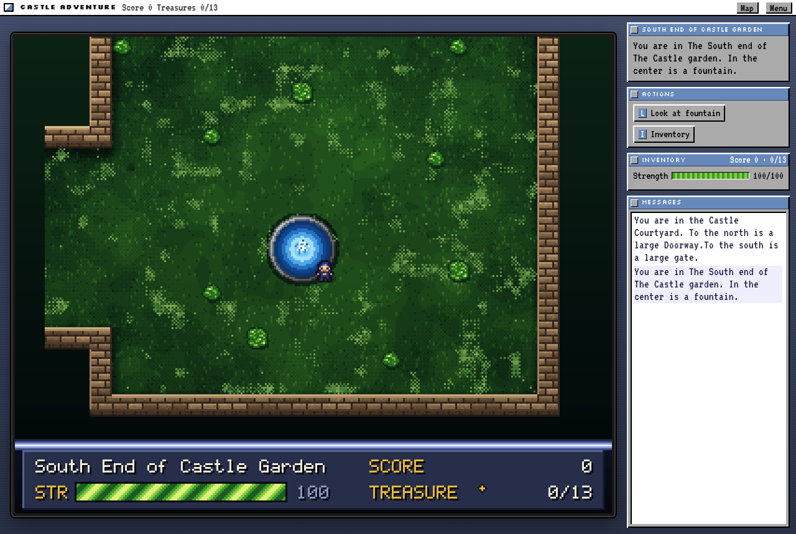
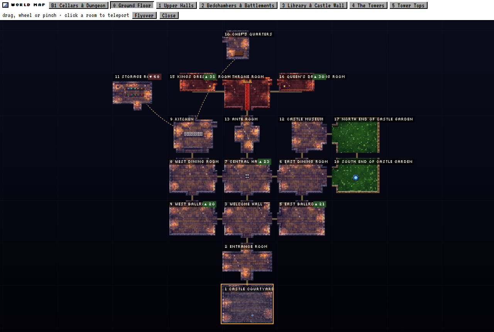

# Castle Adventure

**Kevin Bales' 1984 DOS classic, rebuilt for the browser as if it had shipped on an Amiga 1200.**

▶ **Play it at [castles.bmux.sh](https://castles.bmux.sh)**



All 83 rooms, every item, monster and puzzle, and the original scoring come straight from the
original `CASTLE.RAN` and `CASTLE.EXE`. They are drawn the way the Amiga's AGA chipset would draw
them: 256 indexed colours across eight bitplanes, blitter sprites, copper gradients and
Mark Ferrari-style colour cycling for the water, torches and lava.

## Playing

| | |
|---|---|
| **Move** | Arrow keys or `WASD`. Hold two to walk diagonally. |
| **Actions** | Shown in the side panel, with their key. `1`–`9` work too. |
| **Map** | `M` shows the rooms you've explored. |
| **Menu** | `Esc` to save, load or start over. |
| **Phone** | Tap the d-pad under the screen. |

Your progress is saved automatically every time you change rooms. Escape the castle with all 13
treasures for the perfect score.

## Dev mode

Add [`?dev`](https://castles.bmux.sh/?dev) to the URL, or press `` ` ``, to open the dev panel.
From there you can teleport anywhere, spawn items and see hidden things.



| URL | Does |
|---|---|
| `?worldmap` | Opens the whole castle, floor by floor. Click a room to teleport there. |
| `?flyover` | Opens the map and flies the camera through every room. Press `F` on the map to start it. |
| `?room=18&row=10&col=12` | Skips the title screen and starts at a given room and position. |
| `…&reveal` | Shows hidden items and lights up dark rooms. |
| `…&give=lamp,sword` | Starts with these items. |
| `?seed=3` | Uses a fixed random seed. |

`reveal` and `give` only apply alongside a param that skips the title screen, such as `room`,
`worldmap` or `map`.

## Running locally

There are no dependencies and no build step. You only need Node 22 or later.

```sh
npm start        # http://localhost:8000
npm test         # engine, renderer and a full 1550-point playthrough
```

The browser needs to support JSON module imports: Chrome 123+, Firefox 138+ or Safari 17.2+.

## How it's built

```
original/     CASTLE.EXE and CASTLE.RAN, the 1984 game
data/         rooms, items, monsters and messages extracted from them
src/engine/   the game rules, with no DOM (createGame → act / tick / getState)
src/ui/amiga/ bitplanes, blitter, copper, palette and colour cycling
src/ui/art/   per-room moods, tiles and sprites
src/ui/       the app, HUD, world map, dev tools and saves
tools/        extractors, the dev server and the playthrough bot
```

- **Data.** `tools/extract-rooms.mjs` reads the 575-byte room records in `CASTLE.RAN`. Each record
  holds an 18×24 map, a 5-line description and the exits. Messages are lifted from the compiled
  BASIC strings in `CASTLE.EXE`.
- **Engine.** The engine is deterministic for a given seed, and is tested by a bot that plays the
  whole game to a perfect score.
- **Screen.** The screen is a real planar framebuffer: 320×256 PAL lowres with 8 bitplanes. Each
  frame is blitted, run through a per-scanline copper list and converted to RGB through 256 colour
  registers. Colours are animated by cycling those registers, not by redrawing pixels.

The full design is in [docs/superpowers/specs](docs/superpowers/specs/2026-10-24-castle-adventure-browser-design.md).

## Credits

- *Castle Adventure* © 1984 Kevin Bales. The original game files are included for preservation.
- The [Seed7 remake](https://seed7.sourceforge.net/) by Thomas Mertes was used as a reference
  for the game rules.
- The [Silkscreen](https://fonts.google.com/specimen/Silkscreen) and
  [VT323](https://fonts.google.com/specimen/VT323) fonts are under the SIL Open Font License.
